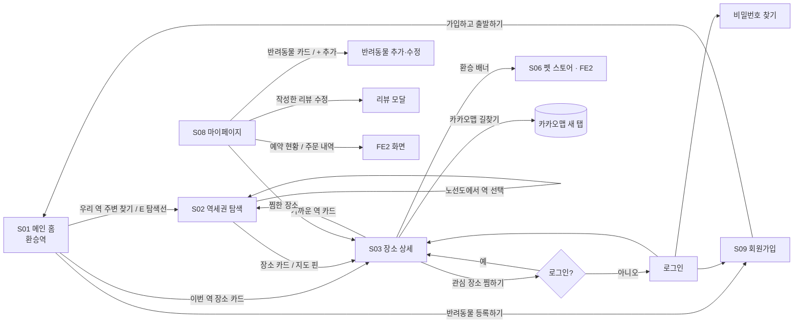

# FE1 화면 흐름 (v2 — 팀 목업 "지하철 노선도 콘셉트" 반영)

> ⚠️ 2026-11-25 지하철 → 버스 · 지역별 탐색으로 바뀌었어요. 역 · 호선 관련 내용은 [docs/09_BUS_TRANSIT.md](../../docs/09_BUS_TRANSIT.md)를 보세요.

목업 화면 번호 기준: **S01 메인 홈 · S02 역세권 탐색 · S03 장소 상세 · S08 마이페이지 · S09 회원가입**
(S04~S07 병원·호텔·스토어·장바구니는 FE2 담당)

## NOW STATION 단계

| 노선 | 단계 | 화면별 현재 단계 |
|---|---|---|
| E 탐색선 | 노선·역 선택 → 역세권 장소 목록 → 장소 상세 → 관심 장소 찜 | S02: 역 선택 전 1단계 / 선택 후 2단계, S03: 3단계, 찜하면 4단계 |
| M 마이선 (가입) | 회원가입 → 반려동물 등록 → 홈 환승 → 마이페이지 | S09: 계정 입력 중 1단계, 반려동물 입력 중 2단계 |
| M 마이선 (마이) | 회원가입 → 반려동물 등록 → 마이페이지 → 통합 리뷰 | S08: 3단계 |

## 라우트

| 경로 | 화면 | 로그인 |
|---|---|---|
| `/` | S01 메인 홈 | - |
| `/explore?line=&stationId=&cat=&sizes=&indoor=&r=&sort=` | S02 역세권 탐색 (상태가 URL에 남음) | - |
| `/places/:placeId?line=&stationId=` | S03 장소 상세 (경로 표시용으로 들어온 호선·역 전달) | - |
| `/signup` | S09 회원가입 · 반려동물 등록 | 비로그인 |
| `/login`, `/find-password` | 로그인 · 비밀번호 찾기 (목업 외 보조 화면, 같은 디자인) | 비로그인 |
| `/mypage` | S08 마이페이지 | ✅ |
| `/pets/new`, `/pets/:petId/edit` | 반려동물 추가·수정 | ✅ |
| `/reservations/hospital`, `/reservations/hotel`, `/hospitals/:id`, `/shop`, `/cart` | **FE2 뼈대 화면** (R 예약선 · S 쇼핑선) — `pages/fe2/` | - |

## 공통 규칙 반영 위치

| 규칙 | 구현 |
|---|---|
| 4색(민트·짙은 초록·크림·테라코타) 외 금지 | `src/styles/tokens.css` — 목업에서 추출한 같은 계열 톤(연민트·베이지)만 추가 |
| 폰트 Gothic A1 / Jost / Bagel Fat One(메인 타이틀만) | `index.html` 구글 폰트, `--font-ko / --font-en / --font-title` |
| 헤더: 로고 · E R S M · 장바구니 · 로그인, 현재 노선 흰 배경 | `components/layout/Site.jsx` `SiteHeader` |
| 페이지 상단: 민트 + 큰 영문 제목 + 한글 제목 + 설명 + 일러스트 | `PageHero` |
| NOW STATION 표시줄 | `NowStation` |
| 선택 버튼: 베이지 바탕 + 선택만 흰 알약·굵게 (어두운 채움 금지) | `OptionGroup` |
| 카드: 흰 배경, 32~40px 둥글게, 테두리 없음 | `.card`, `--r-card: 36px` |
| 주요 동작 1개만 짙은 초록 채움, 나머지 테두리 | `Button variant="primary" / "outline"` |
| 푸터: 짙은 초록, 워드마크, 공공데이터·카카오맵 출처 | `SiteFooter` |
