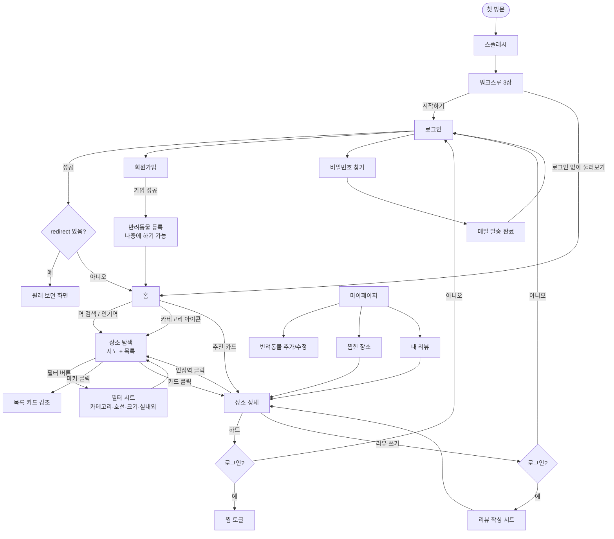

# FE1 화면 흐름도 (Day 2)

회원가입/로그인 + 장소 탐색 화면 흐름입니다. GitHub/VS Code에서 Mermaid로 렌더링됩니다.



## 라우트 표

| 경로 | 화면 | 로그인 | 일차 |
|---|---|---|---|
| `/onboarding` | 스플래시 + 워크스루 | - | D1 |
| `/login` | 로그인 | 비로그인 전용 | D3, D5 |
| `/signup` | 회원가입 | 비로그인 전용 | D3 |
| `/find-password` | 비밀번호 찾기 | - | D3 |
| `/pets/new`, `/pets/:petId/edit` | 반려동물 등록/수정 | ✅ | D3 |
| `/` | 홈 | - | D4 |
| `/explore?stationId=&cat=&lines=&sizes=&indoor=&sort=` | 장소 탐색 (지도·목록·필터) | - | D4, D6, D9 |
| `/places/:placeId` | 장소 상세 (찜·리뷰) | - | D7, D8 |
| `/bookmarks` | 찜한 장소 | ✅ | D7 |
| `/mypage` | 마이페이지 | ✅ | D3 |
| `/reservations/*`, `/shop/*` | **FE2 화면 연결 자리** | - | - |

## 와이어프레임 요약

```
┌ 홈 ───────────────┐  ┌ 장소 탐색 ─────────┐  ┌ 장소 상세 ─────────┐
│ PetPlanet      💗 │  │ [🚇 역 검색      ] │  │ ← (카테고리 일러스트) ↗│
│ 콩이랑 오늘    🐶 │  │ [2][SB] 강남역  ✕ │  │ 카페                │
│ 어디로 갈까요?    │  │ [필터2][☕][🍽]…  │  │ 멍멍살롱 카페       │
│ [🚇 역 검색     ] │  │ ┌──────────────┐ │  │ ★4.8 리뷰5 찜1      │
│ (강남)(홍대)(성수)│  │ │  지도 + 1km 원 │ │  │ [콩이랑 갈 수 있어요]│
│ ☕ 🍽 🏨 🌳 🎨   │  │ └──────────────┘ │  │ [크기][실내외]       │
│ [맞춤 추천 배너 ] │  │ 4곳  가까운순|별점│  │ 가까운 역 / 지도     │
│ 콩이랑 갈 수 있어요│  │ [카드][카드]…    │  │ 리뷰 요약 + 목록     │
│ [카드][카드]→     │  │ [더 보기]         │  │ [♥] [전화로 문의]    │
└ 홈 탐색 예약 쇼핑 마이┘  └──────────────────┘  └──────────────────┘
```
